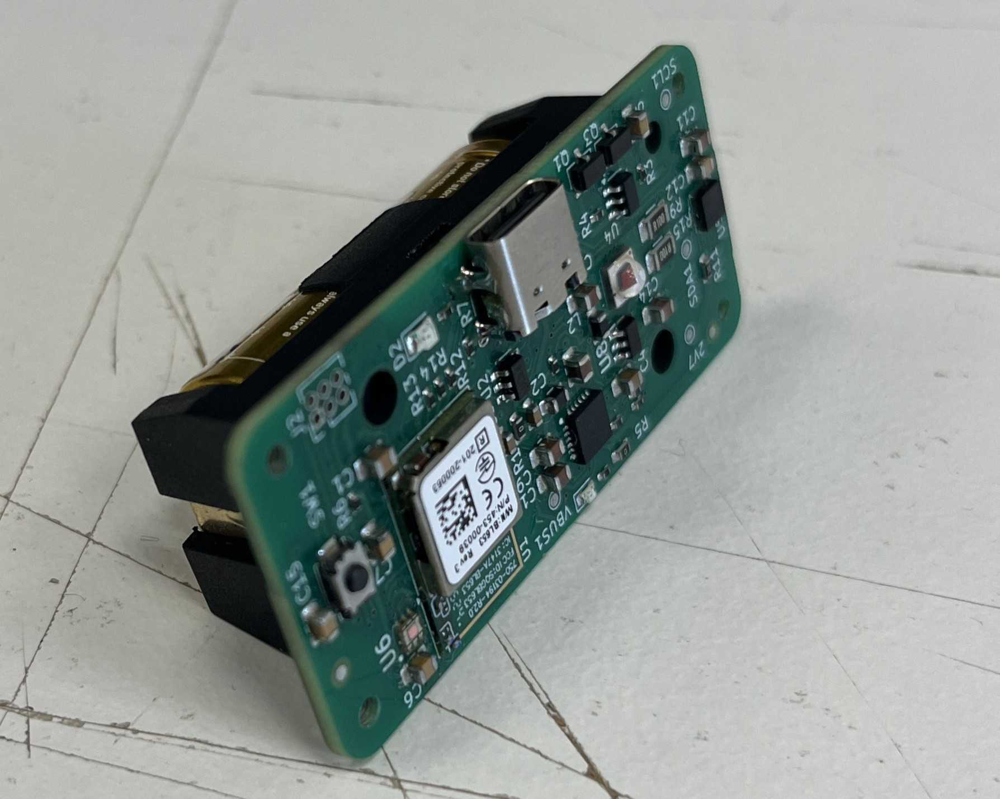
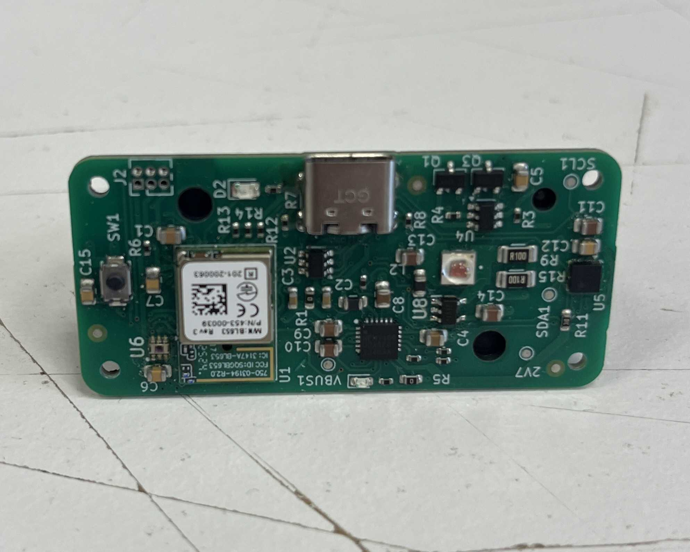
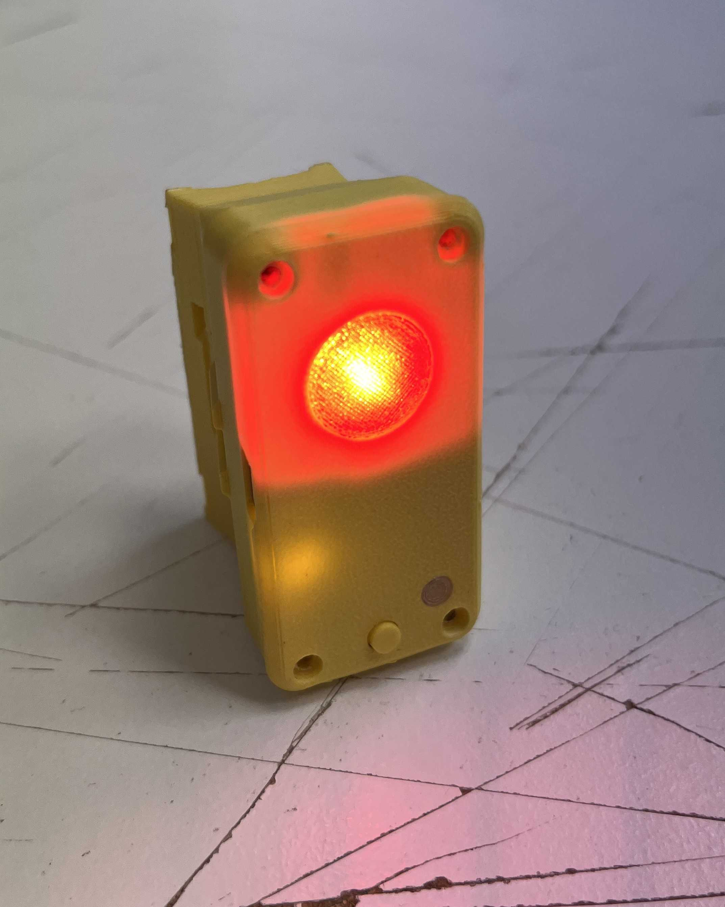
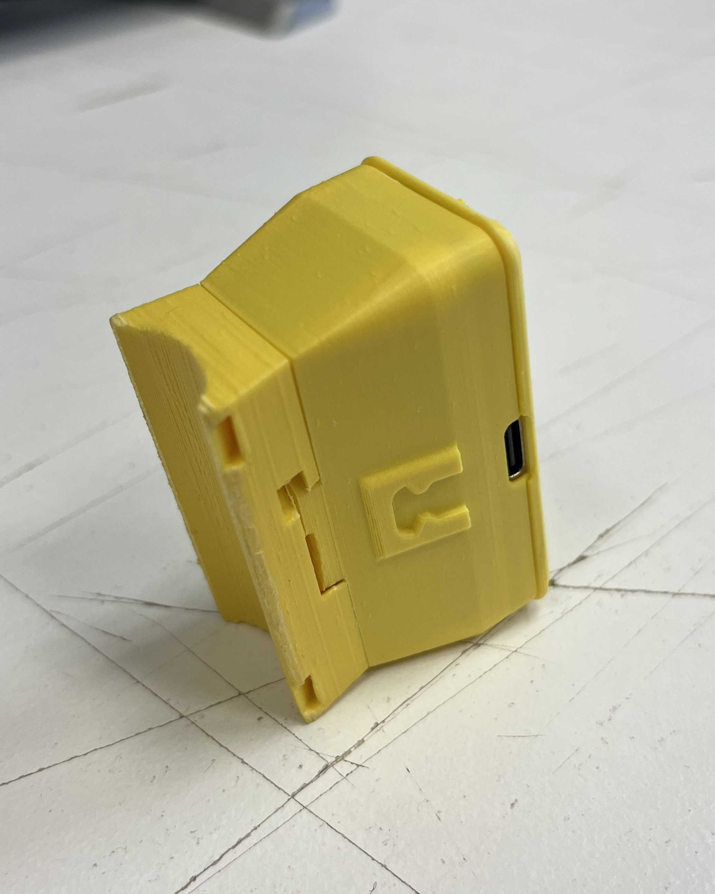

# bike-light-rear

High-visibility rear bicycle light controlled from an ANT+ bike computer (ANT+ Bike Lights profile), featuring smart motion detection, ambient light sensing, and efficient single-cell Li-ion power management. Designed for hybrid assembly (pick-and-place for 0402/0603 passives, hand-soldering for connectors and high-value components).

## Hardware architecture

### Compute & wireless
- **BL653 module** (453-00039R) – Nordic nRF52833 SoC with integrated PCB trace antenna, ANT/Bluetooth radio, and 64 MHz Arm Cortex-M4F (the firmware uses the ANT SoftDevice, so the radio runs ANT+)
- **Programming** – 2×3 1.27mm SWD header for firmware flashing and debugging
- **System power** – 2.7V from NPM1100 buck regulator optimized for 90-95% battery capacity utilization (3.11V cutoff)

### Sensors (I2C bus @ 2.7V)
- **LIS3DH accelerometer** – 3-axis motion detection (braking / fall detection) for brake/acceleration events, configurable thresholds, interrupt-driven
- **OPT3001 light sensor** – 0.01-83k lux range with human-eye spectral matching for automatic brightness control and day/night mode switching

### High-power LED driver
- **Cree XP-E2** (XPEBRD-L1-0000-00801) – 625nm Red emitter driven at 500mA via PAM2804 step-down constant-current driver
- **Control** – PWM dimming via BL653 GPIO with 100kΩ pull-down for safe default-off state

### Power subsystem
- **Battery** – Single 18350 Li-ion cell (Vapcell 1100mAh, unprotected), 3.11-4.2V operating range
- **Charging** – USB-C PD sink (5.1kΩ CC resistors), NPM1100 linear charger @ 400mA (0Ω ICHG resistor), 4.2V termination
- **Protection** – DW01A IC with dual AO3400A N-channel MOSFETs (drain-to-drain configuration) for over-voltage (4.3V), under-voltage (2.5V), and over-current (>2A) protection
- **Buck regulator** – NPM1100 internal 2.7V @ 150mA output
- **Status monitoring** – CHG and ERR signals routed to BL653 GPIO for firmware-based charge status indication
- **NTC disable** – Thermal monitoring disabled via 10kΩ resistor from NTC pin to AVSS (GND)

### PCB specifications
- **Design tool** – KiCad 9.0 (schema version `20250114`)
- **Test points** – Critical nets labeled for bring-up and debugging (+BATT, +VSYS, +VDD_nRF, GND, I2C_SDA, I2C_SCL)

### Hardware photos

Assembled PCB on the 18350 battery holder (angled view).

Top of the populated PCB: BL653 (nRF52833), USB-C, tactile switch, RGB status LED, SWD header (J2), and I2C test point pads for the accelerometer and ambient light sensor.

Front of the 3D-printed enclosure with the Cree red main LED and status indicator.

Side of the enclosure showing the USB charge port.

## Repository layout
- `hardware/` – KiCad project, fabrication-toolkit config, custom libs (`kicad_symbols/`, `kicad_footprints/`, `kicad_3d_models/`), datasheets (markdown format), and generated BOM
- `software/rear_light_ant/` – rear light firmware (bare metal on the ANT SoftDevice S212), including Smart Mode, ANT+ bike light control, charging/idle state, and low-power sleep
- `software/rear_light_peripheral/` – the previous Zephyr/BLE rear light firmware, kept as reference until the physical checks of the ANT+ firmware are done
- `software/front_light_central/` – proof-of-concept BLE central/front-light firmware (experimental). It controlled the BLE rear light and does not work with the ANT+ rear light
- `software/` *(other folders)* – development history and experiments (central/peripheral prototypes, refactors, test projects)
- `docs/` – photos, rendered schematics, mechanical notes, and user-facing manuals
- `LICENSE` – GPLv3 with NonCommercial clause

## Hardware workflow
1. Install KiCad 9.0 or newer.
2. Install the [JLCPCB Fabrication Toolkit](https://github.com/bennymeg/Fabrication-Toolkit) to be able to export the design in the correct format for JLCPCBs [Design For Manufacturing (DFM) Tool](https://jlcdfm.com/).
3. Open `hardware/kicad_project/RearLight.kicad_pro` to access the schematic and PCB.
4. Run ERC/DRC before layout edits; generated artifacts (Gerbers, pick-and-place, STEP export) go to `hardware/kicad_project/production`, which is gitignored and intentionally kept out of releases.
5. Note: Components marked DNP (Do Not Populate) in fabrication files are intended for hand-soldering to minimize assembly costs.

## Firmware

The rear light firmware (`software/rear_light_ant/`) runs bare metal on the **ANT SoftDevice S212 7.0.1** of the **nRF52833 (BL653 module)**. ANT SoftDevices are not supported by Zephyr or the nRF Connect SDK, so it uses a plain Makefile with the compiler of an nRF Connect SDK toolchain installation (v3.1.1) and the register headers of its nrfx. It implements the lighting control with three light modes and is controlled by an ANT+ bike computer through the ANT+ Bike Lights profile (tested with a Wahoo ELEMNT BOLT v2).

### Features
- **Three light modes**: Steady, Flash (double flash) and Smart, plus Off from the bike computer
- **Smart Mode**: Adaptive brightness based on braking detection and ambient light
- **Braking Detection**: Automatic peak brightness boost during deceleration
- **Ambient Light Sensing**: Adjusts brightness for day/night conditions
- **Auto-Off**: Power-saving mode when stationary for 2.5+ minutes
- **Power Management**: Low-battery indication and automatic shut-off at low voltage, USB-C charging indication
- **ANT+ control**: state, battery and mode of the light on the bike computer, mode changes from the bike computer

For complete operating instructions and technical details, see the **[Rear light User Manual](software/rear_light_ant/MANUAL.md)**; the behaviour is specified in [SPEC.md](software/rear_light_ant/SPEC.md).

### Firmware environment setup
1. Install the [nRF Command Line Tools](https://www.nordicsemi.com/Products/Development-tools/nrf-command-line-tools) for access to `nrfjprog` and a J-Link.
2. Install the **nRF Connect SDK toolchain v3.1.1** (nRF Connect for VS Code, Toolchain Manager). Only its GNU Arm compiler and the nrfx register headers are used.
3. Put the ANT SoftDevice archive `ANT_s212_nrf52_7.0.1.zip` (from the Garmin/ANT downloads) into `software/ant_source/SoftDevices_Current_Items/`. The folder is gitignored: the ANT+ documents and SoftDevice files must not be redistributed.
4. `cd software/rear_light_ant && make test && make flash` (see its [README](software/rear_light_ant/README.md) for options, bench tools and the licence key).

The previous Zephyr firmware in `software/rear_light_peripheral/` is built with the nRF Connect for VS Code extension as before (nRF Connect Bare Metal SDK v0.9.0 and toolchain v3.1.1).

Note 1: Device flashing using WSL2  
To connect a J-Link debugger to a WSL instance:
- Open a Windows PowerShell terminal and run:
- `usbipd list`
- `usbipd bind --busid <J-Link BusID>`
- `usbipd attach --wsl --busid <J-Link BusID>`

Note 2: Device does not show up under “Connected Devices” in the nRF Connect VS Code extension
- Install [nRF-Util](https://www.nordicsemi.com/Products/Development-tools/nRF-Util)
- Make nrfutil executable using `chmod +x nrfutil`
- Move the nrfutil executable to a directory in the system $PATH (e.g. /usr/bin)
- Install the _device_ package for nrfutil using `nrfutil install device`
- Restart VSCode. Your device should now show up under _Connected Devices_ in nRF Connect  

## License
This hardware is released under **GPLv3 + NonCommercial**. You may copy, modify, and share for non-commercial use as long as derivatives retain the same license and attribution. See `LICENSE` for full terms.
