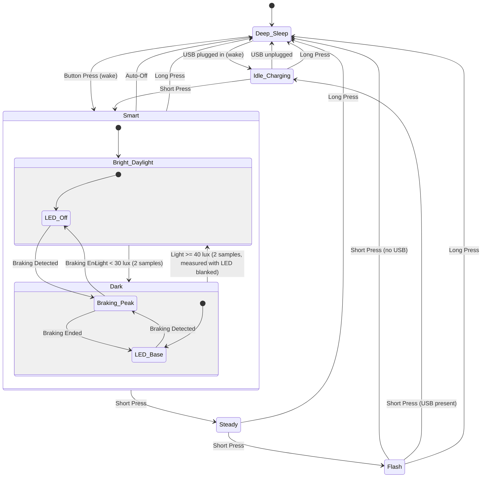

# Bike Light Rear (ANT+) - User Manual

## Overview

The bike light rear is a high-visibility intelligent bicycle tail light featuring three light modes (Steady, Flash, Smart), smart braking detection, ambient light sensing, and automatic power-saving functionality.

## Operating Modes

The light steps through its modes via short button press:

```
Deep Sleep → Smart → Steady → Flash → Deep Sleep
```

The three light modes (Smart, Steady, Flash) are the **Active Modes**. After the last one, a short press enters Deep Sleep, or Idle Charging when USB power is present (see below).

### Deep Sleep
- **Description**: Light is completely off; the processor idles and everything else is stopped (no sensors, no battery sampling, no ANT+ transmission)
- **Power Consumption**: Very low (a few µA expected; to be confirmed by measurement)
- **Wake**: Press the button to wake; the light starts in Smart
- **Bike computer**: The light is not reachable while in Deep Sleep; only the button (or plugging in USB power) wakes it

### Steady
- **Description**: Steady illumination at base brightness
- **PWM Frequency**: 1 kHz
- **Duty Cycle**: 20% (200µs pulse width)
- **Use Case**: General visibility in moderate traffic
- **Activation**: Press button from Smart

### Flash (High Visibility)
- **Description**: Enhanced visibility mode with a periodic double flash
- **Base Brightness**: 200µs pulse width (20% duty), continuous
- **Flash Pattern**: Double flash every 1.5 seconds - peak (800µs, 80% duty) for 70ms, base for 70ms, peak for 70ms, then back to base. The first double flash comes 1.5 seconds after entering the mode.
- **PWM Frequency**: 1 kHz
- **Use Case**: High-traffic environments, increased attention-grabbing
- **Activation**: Press button from Steady

### Smart (Adaptive)
- **Description**: Intelligent adaptive lighting based on environmental conditions and rider behavior
- **Features**:
  - Automatic braking detection
  - Ambient light sensing
  - Automatic power-off when stationary
- **Activation**: Press button from Deep Sleep (wake), Idle Charging or Off
- **See detailed behavior below**

### Off (from the bike computer only)

The light can also be put into **Off** from the bike computer: the light is dark but the device stays awake and reachable, so the bike computer can switch it on again. Off is never entered with the button. A short press in Off starts the first light mode (Smart). Off has no timeout.

### Button behavior summary

- **Short press** (released within 1 second):
  - Steps through the light modes: `Smart → Steady → Flash`
  - After the last light mode (Flash), the light enters **Deep Sleep**, or **Idle Charging** when USB power is present. A short press in Idle Charging (or in Off) starts the first light mode again (Smart).
  - **Selection window (about 15 to 20 seconds):** you can step through the light modes only for a short time after the light was switched on (from Deep Sleep, Off or Idle Charging, also after a restart). After that, a short press in any light mode switches the light off (Deep Sleep, or Idle Charging when USB power is present) instead of going to the next mode. For example, in Steady after the window, a press goes to Deep Sleep, not to Flash. Nothing signals the end of the window. To change the mode later, switch the light off and on again. The length varies by up to 5 seconds because the window is counted in battery sampling ticks.
- **Long press** (held for 1 second or longer):
  - Turns the light **off immediately from any mode**. It enters Deep Sleep, or **Idle Charging** when USB power is present (the status LED then keeps blinking to show charging). In Idle Charging a long press does nothing. It acts at the 1 second mark; you do not have to release first.
- **Wake from sleep**:
  - After the light has turned itself fully off and entered Deep Sleep, a press wakes it and starts in Smart. The wake press does nothing else; keep holding it and nothing more happens, and the next press counts as a new press.

## Smart Mode Detailed Behavior

Smart adapts LED brightness based on three environmental factors.
Brightness priority: **Braking (Peak, 800µs) > Darkness (Base, 200µs) > Off**.

When Smart starts, the LED is off until the first dark detection (about one second in the dark).

### 1. Braking Detection

**Detection Criteria:**
- The Z-axis acceleration (positive = decelerating, negative = accelerating, sensor mounted with Z along the direction of travel) is corrected for gravity with a slow baseline (time constant 8 s) and averaged over 150 ms
- Braking starts when this value stays above **+5.0 m/s²** for **100 ms** (2 samples at 50 ms)

**Behavior When Braking:**
- LED immediately switches to **Peak brightness** (800µs PWM)
- Overrides ambient light settings
- The baseline stops adapting while braking, so a long brake does not cancel itself out

**Braking End Detection:**
- The value stays at or below +5.0 m/s² for **150 ms**, and the light keeps shining for **0.5 more seconds** (`BRAKING_HOLD_MS`) after the braking phase has ended. Braking again during that time keeps the light on without a gap
- LED returns to the brightness dictated by ambient light

### 2. Ambient Light Control

- **Ambient threshold**: < 30 lux for 2 consecutive samples → LED at base brightness
- **Off point**: ≥ 40 lux (threshold + 10 lux offset) for 2 consecutive samples → LED off. The offset only prevents flicker around the toggle point
- **LED blanking**: the LED's own light reflects into the light sensor inside the housing and would end the darkness by itself. While the LED is lit at base brightness, the ambient light is therefore measured with the LED switched off for about 120 ms, once every **30 s**. This is a short, visible dropout of the light. If such a measurement shows daylight, it is confirmed after 0.5 s (a second short dropout) and the LED then stays off
- No measurement is taken while braking (the LED is at peak). The first one follows 0.5 s after braking ended
- While the LED is off, the light sensor is read every 0.5 s without any blanking

### 3. Automatic Power-Off

**Stationary Detection:**
- Monitors acceleration magnitude: √(x² + y² + z²)
- Expected value when stationary: ~9.81 m/s² (Earth's gravity)
- Tolerance: ±100% (0 - 19.62 m/s²)

**Auto-Off Criteria:**
- **2.5 minutes** (150 s) of uninterrupted samples within the stationary range
- Any sample outside the range (road vibration, movement) resets the counter
- Only active in Smart

**When Auto-Off Triggers:**
- Light switches off and enters Deep Sleep to save battery, or Idle Charging when USB power is present (the status LED then blinks to show charging).
- Requires a manual button press to reactivate (starts in Smart).

### Sensor failure

If a sensor does not start, Smart keeps working with the other one. Without the light sensor the LED stays off. Without the accelerometer there is no braking boost and no auto-off.

## Charging & Battery Behavior

### Normal charging

- **USB-C port** on the light is used for charging the 18350 cell. Charging is done by autonomous hardware, also while the light is in Deep Sleep.
- Powering up with **USB power** boots the light into **Idle Charging** (main LED off). Plugging in USB while in Deep Sleep also wakes it into Idle Charging, within about a second.
- **Plugging in USB while the light is on never changes the mode**, so the light stays on, for example if a power bank is connected mid-ride. Only the status LED changes.
- While USB power is present, the **status LED blinks fast (300ms)** to show charging activity, in every awake state.
- **Unplugging USB** while in Idle Charging powers the light off (Deep Sleep); press the button to turn it back on.

### Low-battery indication and shut-off

- Battery voltage is sampled every 5 seconds in all modes.
- **Low battery** (below ~3.4V for 3 consecutive samples): the status LED blinks slowly (500ms) to signal that a recharge is due. Recovers automatically when the voltage stays at or above 3.4V. **The status LED is the only low-battery warning**: it is meant to be seen by the rider, and the main light is not changed in any way until the battery is critical.
- **Critical battery** (below ~3.0V for 3 consecutive samples): the light turns off and enters Deep Sleep to protect the cell, or Idle Charging when USB power is present.
- To use the light again, **recharge the battery** and press the button to wake it. Waking with a critical battery turns the light on briefly until the critical shut-off triggers again.
- Battery readings are not reliable while USB power is present.

### Status LED priority

1. Low battery → 500ms blink
2. Charging (USB power present) → 300ms blink
3. Light in an active mode → solid on
4. Off from the bike computer (light dark, awake and reachable) → short pulse (0.1 s) every 2 seconds
5. Otherwise (Deep Sleep) → off

## Technical Specifications

### Sensor System

**Accelerometer (LIS3DH):**
- 3-axis motion detection
- Polling interval: 50ms (20 Hz), only while in Smart
- Output data rate: 25 Hz
- Range: ±2g typical
- Interface: I²C

**Light Sensor (OPT3001):**
- Range: 0.01 - 83,000 lux
- Human-eye spectral matching
- Conversion time: 100 ms, set by the firmware (the driver default is 800 ms)
- Sampling Rate: 500ms (2 Hz) while the LED is off, once every 30 s (with the LED blanked) while the LED is lit at base brightness, only while in Smart
- Interface: I²C

### LED Driver

**LED Specifications:**
- Type: Cree XP-E2 Red (625nm)
- Drive Current: 500mA
- Driver: PAM2804 constant-current step-down

**PWM Control:**
- Frequency: 1 kHz (1000µs period)
- Resolution: 1µs
- Brightness Levels:
  - Off: 0µs pulse width
  - Base: 200µs pulse width (20% duty)
  - Peak (braking/flash): 800µs pulse width (80% duty)

### Power Management

**Battery:**
- Type: Single 18350 Li-ion cell
- Capacity: 1100mAh (Vapcell)
- Operating Range: 3.11V - 4.2V

**System Voltage:**
- Regulated: 2.7V (NPM1100 buck regulator)
- Efficiency: 90-95% battery utilization

**Protection:**
- Over-voltage: 4.3V cutoff
- Under-voltage: 2.5V cutoff (DW01A protection IC)
- Over-current: >2A protection

**Battery Measurement:**
- SAADC on AIN5 through a 1M/100k divider, sampled every 5 seconds

## State Transition Diagram



"Smart → Steady → Flash" is the configured mode order. The mode arrows apply only within the selection window of about 15 to 20 seconds after switching on; after it, a short press in any light mode goes to Deep Sleep (or Idle Charging with USB power present). A different order changes the arrows between the light modes, but Idle Charging (or Deep Sleep) always follows the last one. Off (from the bike computer only) is not shown.

## Usage Recommendations

### Daytime Riding
- Use **Flash** mode for maximum visibility in bright conditions
- Or use **Smart** which will activate only during braking

### Night Riding
- Use **Steady** for steady visibility
- Or use **Smart** which provides the base brightness with braking boost

### Commuting
- **Smart** is ideal for mixed urban/traffic conditions
- Automatic brightness adjustment reduces manual intervention
- Auto-off prevents battery drain if bike is left stationary

## Control from an ANT+ bike computer

The rear light is an **ANT+ bike light** (ANT+ Bike Lights profile). A bike computer that supports ANT+ lights (tested with a Wahoo ELEMNT BOLT v2) shows its state and battery and can switch its mode. The light only transmits while it is awake (not in Deep Sleep). There is no pairing: ANT+ commands are **not authenticated**, so any ANT+ controller in range can change the mode.

### Adding the light

1. Wake the light with the button (it starts in Smart).
2. On the bike computer, search for sensors and add the ANT+ light. It shows up as a tail light with a device number that is the same every time.
3. The bike computer then lists the modes the light offers: **20 %** (Steady), **slow flash** (Flash) and **auto** (Smart). Off is switched with the bike computer's own off function.

### What the bike computer shows and does

| Bike computer | Light |
| --- | --- |
| Mode "20 %" | Steady |
| Mode "slow flash" | Flash |
| Mode "auto" | Smart |
| Off | Off (dark, awake and reachable; the status LED pulses briefly every 2 s so you can tell it from Deep Sleep; the button starts Smart again) |
| Battery | New, good, ok, low, critical from the cell voltage; "charging" while USB power is present |

- Idle Charging (USB power present, light off) appears as Off with the battery shown as charging. It cannot be commanded.
- A mode change from the bike computer is ignored for 3 seconds after any change at the light itself (button, boot), so the bike computer cannot fight a button press.
- Button presses and the safety features (braking, auto-off, low battery) always take priority.
- After the bike computer has connected, the light reports itself as connected. If no message arrives from the bike computer for 2 minutes, it returns to the unconnected state; **the main LED is not changed by this**, so the light never goes dark just because the bike computer is switched off or out of range. The bike computer connects again by itself.
- If the ANT+ stack cannot start (for example a hardware fault), the light still works with the button.

## Firmware Information

**Build System:** GNU Arm toolchain (from the nRF Connect SDK installation), plain Makefile, no RTOS
**Target Device:** Nordic nRF52833 (BL653 module)
**Radio:** ANT SoftDevice S212 7.0.1 (ANT only), internal RC oscillator as low-frequency clock
**Programming Interface:** SWD (Serial Wire Debug)

**Software Architecture:**
- Event-driven central state machine: every input (button, bike computer command, battery tick, USB plug/unplug, sensor detections) is posted as an event into one queue
- The main loop is the only consumer of the queue, the only writer of system state and the only place that chooses the light output
- Sensors: accelerometer (50 ms) and light sensor (500 ms) are sampled on independent schedules in Smart by a timer in the main loop; the ambient light blank is a sequence of timer steps, so nothing blocks. Edge events (brake start/stop, dark/bright, stationary timeout) are posted to the queue. Detection times are defined in milliseconds, independent of the sampling intervals
- Interrupts and timers only post events - no state is modified outside the main loop
- If the main LED, status LED or button fails to initialize at boot, the firmware resets instead of stopping; if the SoftDevice cannot start the light works without ANT+
- There is no watchdog; a SoftDevice fault resets the chip
- The portable core (state machine, battery logic, detectors, ANT+ page logic) has no hardware access and is tested on the PC (`make test`)

**Key Configuration Options:**
- `MODE_SELECT_WINDOW_BATTERY_TICKS`: 4 battery ticks (5 s each) = 15 to 20 s (in `src/config.h`)
- `BRAKING_ACCEL_THRESHOLD_MILLI`: +5000 milli-m/s² (in `src/config.h`)
- `BRAKING_START_CONFIRM_MS` / `BRAKING_STOP_CONFIRM_MS` / `BRAKING_HOLD_MS` / `BRAKING_SMOOTHING_MS` / `BRAKING_BASELINE_TAU_MS`: 100 / 150 / 500 / 150 / 8000 ms (in `src/config.h`)
- `ACCEL_SAMPLING_INTERVAL_MS` / `LIGHT_SAMPLING_INTERVAL_MS` / `ACCEL_ODR_HZ`: 50 / 500 ms / 25 Hz (in `src/config.h`)
- `AMBIENT_THRESHOLD_MILLILUX` / `AMBIENT_OFF_OFFSET_MILLILUX`: 30 / 10 lux (in `src/config.h`)
- `LIGHT_BLANK_INTERVAL_MS` / `AMBIENT_BLANK_SETTLE_MS` / `AMBIENT_BLANK_TIMEOUT_MS`: 30000 / 2 / 250 ms (in `src/config.h`)
- `STATIONARY_TIMEOUT_MS`: 150000 ms = 2.5 minutes (in `src/config.h`)
- `BATTERY_CRITICAL_MV` / `BATTERY_LOW_MV`: 3000 / 3400 mV (in `src/config.h`)
- `LIGHT_PULSE_BASE` / `LIGHT_PULSE_PEAK`: 200 / 800 µs (in `src/config.h`)

See `SPEC.md` for the full behavioural specification and `CONTEXT.md` for the terminology.

## License

Copyright © 2025 Matthias Dippold

This firmware is released under **GPLv3 + NonCommercial**.
See LICENSE file for complete terms.

---

**Firmware Version:** 3.0.0 (ANT+, bare metal on the S212 SoftDevice)
**Last Updated:** October 2026
**For support and updates:** See main README.md
